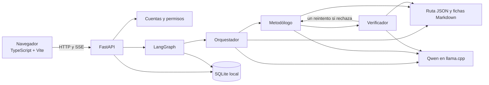

# Hilo · asistente metodológico multiagente

Hilo es un prototipo de trabajo de grado para acompañar proyectos de innovación.
Combina una ruta metodológica con un asistente de tres roles, proyectos persistentes,
herramientas interactivas y colaboración entre cuentas de una misma instalación.
Este README explica cómo instalar la aplicación, cómo funciona y dónde está cada
documento.

> **Estado:** prototipo local para Windows y Linux. La interfaz y el modelo escuchan en
> `127.0.0.1`. Publicar el código en GitHub no publica la aplicación ni permite
> que otros computadores entren a los proyectos guardados en esta máquina.

## Contenido

- [Funciones disponibles](#funciones-disponibles)
- [Requisitos](#requisitos)
- [Instalación desde cero](#instalación-desde-cero)
- [Iniciar y detener](#iniciar-y-detener)
- [Arquitectura](#arquitectura)
- [Datos y configuración](#datos-y-configuración)
- [Estructura del repositorio](#estructura-del-repositorio)
- [Documentación](#documentación)
- [Desarrollo y pruebas](#desarrollo-y-pruebas)
- [Ramas](#ramas)
- [Problemas frecuentes](#problemas-frecuentes)

## Funciones disponibles

- **Asistente metodológico:** LangGraph coordina Orquestador, Metodólogo y
  Verificador. La ruta tiene 10 etapas y 15 fichas habilitadas. CrewAI permanece
  como línea base para comparación.
- **Cuentas y proyectos:** registro, inicio de sesión, carpetas de proyectos,
  contexto del reto, historial de chat, memoria persistente y Post-its.
- **Colaboración local:** invitaciones a otras cuentas de esta instalación,
  permisos de lectura o edición, avances comunes y chat privado por participante.
- **Árbol de problemas:** tablero de problema central, causas y efectos que se
  guarda por proyecto con control de versiones. Un origen escrito en el árbol no
  se convierte automáticamente en evidencia verificada.
- **Análisis de cinco porqués:** parte de una causa del árbol, registra la cadena
  paso a paso y permite incorporar la causa candidata al árbol.
- **Vistas propias por herramienta:** PESTEL (seis factores con post-its,
  oportunidad o amenaza y prioridad), mapa de empatía (lo observado separado de lo
  supuesto) y Customer Journey (etapas, curva de emoción y lectura de notas de
  entrevista que propone post-its citando el texto). El agente lee estos tableros
  como borradores del equipo.
- **Temas sensibles:** crisis personal, daño, contenido sexual, odio, opinión
  política o religiosa y consejo médico, legal o financiero reciben una respuesta
  fija del sistema, sin pasar por el modelo.
- **Agenda:** calendario y tareas personales o vinculadas a proyectos, con fecha,
  prioridad y estado.
- **Seguimiento del agente:** la interfaz muestra el flujo, reintentos, dictamen
  y ficha metodológica utilizada.
- **Protección del acceso:** límite de intentos de inicio de sesión, tope de
  tamaño por petición y carpeta de datos privada en Linux. Detalle en
  [`docs/guia-del-prototipo.md`](docs/guia-del-prototipo.md#protección-del-acceso).

Las fichas son material de trabajo del prototipo. La aprobación del Verificador
no equivale a validación experta. Todavía no hay RAG vectorial ni acceso remoto
entre computadores.

## Requisitos

| Componente | Requisito para esta configuración |
| --- | --- |
| Sistema | Windows x64 con PowerShell, o Linux x86-64 (Ubuntu o Linux Mint) con bash |
| Python | 3.10 a 3.13; [`.python-version`](.python-version) fija 3.13 |
| Gestor Python | `uv`, instalado como módulo de Python |
| Frontend | Node.js y npm (probado con Node.js 24), y `pnpm` 11.15.1 (según [`package.json`](frontend/package.json)); en Linux también `rsync` |
| Modelo local | El instalador descarga Qwen3.5-4B y llama.cpp. Windows: CUDA 12.4 (NVIDIA). Linux: CUDA 12.8 (controlador NVIDIA 570 o posterior), Vulkan o solo CPU |
| Espacio | Aproximadamente 3,4 GB de descargas para modelo y runtime, más dependencias y datos |

En Windows el instalador usa la compilación CUDA. En Linux elige solo el motor
más rápido disponible (CUDA, Vulkan o CPU) y `--backend` permite forzar otro. Con
CPU cada respuesta tarda varios minutos.

## Instalación desde cero

### Windows

Abre **PowerShell**. Instala Python, Node.js y Git si aún no están disponibles;
comprueba sus comandos y luego instala los gestores del proyecto:

```powershell
python --version
node --version
git --version
python -m pip install --user uv
npm install --global pnpm@11.15.1
python -m uv --version
pnpm --version
```

Clona el repositorio y entra en su carpeta:

```powershell
git clone https://github.com/crparra4/sma-metodologias-innovacion.git
cd .\sma-metodologias-innovacion
```

Instala el backend y el frontend. `uv` crea `.venv` en la raíz del repositorio; el
frontend usa el lockfile de pnpm:

```powershell
python -m uv --system-certs sync --extra dev --link-mode copy
pnpm --dir frontend install --frozen-lockfile
pnpm --dir frontend build
Copy-Item .env.example .env
```

Abre `.env` con un editor y **reemplaza** el valor de `RUTA_DIA_API_KEY` por una
clave privada elegida para esta instalación. El ejemplo ya selecciona LangGraph,
Qwen y `http://127.0.0.1:18083/v1`. No compartas `.env` ni lo subas a Git.
La clave se usa entre el backend y llama.cpp en tu computador.

Para descargar el modelo por separado, ejecuta:

```powershell
.\.venv\Scripts\python.exe scripts/install_local_model.py
```

La descarga se verifica con SHA-256 y puede reanudarse ejecutando de nuevo ese
comando. Los archivos quedan en `%LOCALAPPDATA%\QwenLocalTest`, fuera del
repositorio. También puedes omitir este paso: el script de inicio los descarga
cuando faltan.

### Linux

Instala las herramientas (Ubuntu o Linux Mint) y abre una terminal nueva después
de instalar `uv`:

```bash
sudo apt install git nodejs npm rsync
sudo npm install --global pnpm@11.15.1
curl -LsSf https://astral.sh/uv/install.sh | sh
```

Clona el repositorio, prepara la configuración y construye la interfaz:

```bash
git clone https://github.com/crparra4/sma-metodologias-innovacion.git
cd sma-metodologias-innovacion
cp .env.example .env              # luego reemplaza RUTA_DIA_API_KEY
bash scripts/build_frontend.sh
```

`build_frontend.sh` instala las dependencias del frontend sobre una copia en
`~/.cache/hilo-frontend` y deja el resultado en `frontend/dist`. Con una tarjeta
NVIDIA instala antes el controlador (`sudo ubuntu-drivers install`, reinicia y
comprueba con `nvidia-smi`); para Vulkan hace falta `sudo apt install libvulkan1`.

## Iniciar y detener

### Windows

Todos los comandos siguientes se ejecutan desde la raíz del repositorio:

```powershell
# Inicia Qwen, la API y la interfaz; abre el navegador.
.\scripts\start_interface.ps1

# Comprueba la API local.
Invoke-RestMethod http://127.0.0.1:8787/api/status

# Detiene la interfaz y después el modelo.
.\scripts\stop_interface.ps1
.\.venv\Scripts\python.exe scripts/local_model.py stop
```

La aplicación se abre en **http://127.0.0.1:8787/**. En una instalación nueva,
registra la primera cuenta desde esa página. Las cuentas y proyectos de otro
computador no vienen en la descarga de GitHub. Usa `-NoBrowser` para iniciar sin
abrir el navegador. Para otro puerto de interfaz, usa `-Port 8788` al iniciar y
al detener.

El modelo puede administrarse de forma independiente:

```powershell
.\.venv\Scripts\python.exe scripts/local_model.py start
.\.venv\Scripts\python.exe scripts/local_model.py status
.\.venv\Scripts\python.exe scripts/local_model.py stop
```

### Ejecutar cada componente por separado

Para desarrollo puedes usar tres terminales PowerShell, todas situadas en
la raíz del repositorio:

```powershell
# Terminal 1: inicia el modelo en segundo plano (puedes cerrar esta terminal).
.\.venv\Scripts\python.exe scripts/local_model.py start

# Terminal 2: deja la API y el frontend compilado en primer plano.
.\.venv\Scripts\hilo.exe web --port 8787

# Terminal 3: inicia Vite con recarga automática del frontend.
pnpm --dir frontend dev
```

En este modo, abre `http://127.0.0.1:5173/` para trabajar con Vite o
`http://127.0.0.1:8787/` para ver la compilación servida por FastAPI. Detén los
procesos en primer plano con `Ctrl+C` y el modelo con `local_model.py stop`.

### Linux

Desde la raíz del repositorio:

```bash
# Inicia Qwen, la API y la interfaz; abre el navegador.
bash scripts/start_interface.sh

# Detiene la interfaz; con --model también detiene el modelo y libera la GPU.
bash scripts/stop_interface.sh --model
```

La primera vez, `start_interface.sh` crea el entorno de Python en `~/.venvs/hilo`
(se cambia con `HILO_VENV`), descarga el modelo y el motor, e inicia todo. Acepta
`--port 8788` y `--no-browser`. Si el modelo no arranca, prueba otro motor:

```bash
~/.venvs/hilo/bin/python scripts/install_local_model.py --backend vulkan
```

## Arquitectura



1. El navegador llama a FastAPI. El chat transmite eventos de ejecución por SSE;
   el backend también sirve el frontend compilado.
2. El Orquestador selecciona etapa y herramienta desde el índice de la ruta. El
   Metodólogo recibe una ficha. El Verificador evalúa su respuesta contra esa
   ficha y los datos aportados. Pydantic valida los contratos y hay controles
   deterministas antes de guardar resultados.
3. Si el Verificador rechaza, el grafo permite un reintento del Metodólogo. Un
   segundo rechazo produce una respuesta de degradación explícita. Si falta
   una ficha, el sistema comunica el vacío.
4. `DirectOpenAIRuntime` llama a llama.cpp en `127.0.0.1:18083`; el navegador
   no consulta directamente al modelo.
5. SQLite conserva cuentas, permisos, proyectos, chat, avances y checkpoints.
   El catálogo metodológico permanece en JSON y Markdown versionados.

La arquitectura detallada está en
[`arquitectura-langgraph.md`](docs/arquitectura-langgraph.md).

## Datos y configuración

Las rutas de esta tabla son las de Windows. En Linux, `%LOCALAPPDATA%\RutaDIA`
es `~/.local/share/RutaDIA` y `%LOCALAPPDATA%\QwenLocalTest` es
`~/.local/share/QwenLocalTest`. Al iniciar en Linux, la carpeta de datos queda
accesible solo para tu usuario (permisos 700 y 600).

| Ubicación | Contenido |
| --- | --- |
| `.env` | Configuración y clave local; ignorado por Git |
| `%LOCALAPPDATA%\QwenLocalTest` | GGUF, llama.cpp y archivos del proceso del modelo |
| `%LOCALAPPDATA%\RutaDIA\auth.sqlite3` | Cuentas, sesiones, invitaciones, miembros, avances y árboles compartidos |
| `%LOCALAPPDATA%\RutaDIA\notebooks.sqlite3` y `checkpoints.sqlite3` | Datos y checkpoints heredados de la primera cuenta |
| `%LOCALAPPDATA%\RutaDIA\users\<id>\` | Datos y checkpoints separados de otras cuentas |
| `data/` | Auditorías y resultados de evaluación locales; ignorados por Git |

`RUTA_DIA_DATA_DIR` permite elegir otra carpeta de datos. Para respaldar la
instalación, detén la interfaz y copia **toda** la carpeta `%LOCALAPPDATA%\RutaDIA`:
incluye la base de cuentas y las carpetas de los usuarios. Copiar solo
`notebooks.sqlite3` no conserva por sí mismo cuentas ni proyectos compartidos.

Variables principales de [`.env.example`](.env.example):

| Variable | Uso |
| --- | --- |
| `RUTA_DIA_RUNTIME` | `langgraph` para la interfaz local; `crewai` como línea base |
| `RUTA_DIA_MODEL` | Alias del modelo, `Qwen3.5-4B-Q4_K_M` en el ejemplo |
| `RUTA_DIA_BASE_URL` | Endpoint local `http://127.0.0.1:18083/v1` |
| `RUTA_DIA_API_KEY` | Clave privada para el servidor local del modelo |
| `RUTA_DIA_DATA_DIR` | Carpeta opcional para datos persistentes |

La interfaz está restringida a localhost. El código actual no incluye despliegue
remoto, HTTPS ni una base de datos compartida entre computadores.

## Estructura del repositorio

El repositorio sigue la disposición estándar de un proyecto Python con carpeta `src/`.
El código del servicio se organiza por **contextos delimitados** (DDD): cada carpeta de
`src/hilo/` es un contexto, y `tests/test_arquitectura.py` comprueba en cada cambio que
solo use los contextos que le corresponden. El detalle está en
[`docs/dominio-ddd.md`](docs/dominio-ddd.md).

```text
.
├── src/hilo/                 # Servicio en Python (FastAPI + LangGraph)
│   ├── web.py, cli.py, config.py   # Capa de entrada: API HTTP, línea de comandos y configuración
│   ├── acompanamiento/       # Núcleo: agentes, grafo de LangGraph, Planificador y Verificador
│   ├── conocimiento/         # Ruta metodológica y fichas
│   ├── herramientas/         # Árbol de problemas, cinco porqués, PESTEL, empatía y recorrido
│   ├── practica/             # Práctica de entrevista con el Cliente simulado
│   ├── proyectos/            # Proyectos, memoria, notas, tareas y proyectos compartidos
│   ├── evaluacion/           # Evaluación y métricas
│   ├── identidad/            # Cuentas, sesiones y permisos
│   ├── inferencia/           # Acceso al modelo local, cola de turnos y respaldo
│   └── compartido/           # Contratos entre agentes y errores de dominio
├── tests/                    # Pruebas automatizadas, incluida la de arquitectura
├── frontend/                 # Interfaz web (Vite y TypeScript)
├── knowledge/                # La metodología, separada del código
│   ├── routes/               # Ruta: fases, etapas y herramientas habilitadas
│   ├── tools/                # Fichas de herramientas
│   └── frameworks/           # Marcos teóricos de apoyo
├── scripts/                  # Instalación del modelo, arranque y parada (.ps1 y .sh)
├── evaluation/               # Casos y protocolo de evaluación
├── docs/                     # Arquitectura, dominio, contenedores, interfaz y pruebas
├── Dockerfile, compose.yaml  # Imagen y despliegue en contenedor
├── pyproject.toml, uv.lock   # Dependencias de Python
└── .github/workflows/        # Integración continua (lint, pruebas y compilación)
```

## Documentación

| Documento | Contenido |
| --- | --- |
| [`docs/guia-del-prototipo.md`](docs/guia-del-prototipo.md) | CLI, memoria y evaluación del núcleo multiagente |
| [`docs/interfaz-local.md`](docs/interfaz-local.md) | Interfaz, cuentas, proyectos, Post-its, agenda y árbol |
| [`docs/guia-de-pruebas.md`](docs/guia-de-pruebas.md) | Pruebas manuales del árbol, el diagnóstico y los cinco porqués |
| [`docs/recuperacion-qwen-2026-09-29.md`](docs/recuperacion-qwen-2026-09-29.md) | Diagnóstico y arreglo del motor de llama.cpp |
| [`docs/arquitectura-langgraph.md`](docs/arquitectura-langgraph.md) | Flujo LangGraph, responsabilidades y persistencia |
| [`docs/arquitectura.md`](docs/arquitectura.md) | Decisión inicial con CrewAI; documento histórico |
| [`docs/plan-compartir-proyectos.md`](docs/plan-compartir-proyectos.md) | Primera versión local y ampliaciones de colaboración pendientes |
| [`docs/configuracion-qwen3.5-4b-2026-09-09.md`](docs/configuracion-qwen3.5-4b-2026-09-09.md) | Configuración de Qwen y batería técnica |
| [`docs/comparacion-local-qwen-2026-09-07.md`](docs/comparacion-local-qwen-2026-09-07.md) | Comparación exploratoria de modelos |
| [`docs/prueba-qwen-local-2026-09-07.md`](docs/prueba-qwen-local-2026-09-07.md) | Prueba exploratoria del modelo de 27B |
| [`evaluation/PROTOCOL.md`](evaluation/PROTOCOL.md) y [`cases.json`](evaluation/cases.json) | Protocolo y casos del piloto |
| [`knowledge/frameworks/README.md`](knowledge/frameworks/README.md) | Marcos teóricos; fichas ejecutables en [`knowledge/tools/`](knowledge/tools/) |

Los informes con fecha describen ejecuciones concretas; sus cifras de pruebas
no representan necesariamente el estado más reciente del repositorio.

## Desarrollo y pruebas

Desde la raíz del repositorio, ejecuta las comprobaciones sin enviar mensajes al modelo:

```powershell
.\.venv\Scripts\hilo.exe validate
.\.venv\Scripts\python.exe -m pytest -q
.\.venv\Scripts\python.exe -m ruff check .
pnpm --dir frontend build
node --test frontend/tests/agenda.test.mjs
```

En Linux, con el entorno de `start_interface.sh`:

```bash
~/.venvs/hilo/bin/python -m pytest -q
~/.venvs/hilo/bin/python -m ruff check .
bash scripts/build_frontend.sh
```

Para desarrollar el frontend con recarga automática, deja el backend encendido
y ejecuta `pnpm --dir frontend dev`; Vite reenvía `/api` a `127.0.0.1:8787`.
Después de cambiar el frontend, recompílalo si lo abrirás desde FastAPI. Después
de cambiar Python, reinicia la interfaz.

La CLI permite un turno directo, conversación persistente y consulta de memoria;
los comandos están en [`docs/guia-del-prototipo.md`](docs/guia-del-prototipo.md). Las rutas de
la API se agrupan en `/api/auth`, `/api/notebooks`, `/api/projects`, `/api/tasks`
y `/api/chat`. `/api/status` permite comprobar interfaz y modelo.

## Ramas

| Rama | Uso |
| --- | --- |
| `main` | Versión estable; la que se congela para la validación con participantes |
| `develop` | Desarrollo del día a día |
| `staging` | Pruebas de una versión antes de pasarla a `main` |

Los cambios se hacen en `develop`, se prueban en `staging` y pasan a `main`.

## Problemas frecuentes

| Síntoma | Comprobación y acción |
| --- | --- |
| Faltan archivos de Qwen o llama.cpp | Desde la raíz del repositorio, ejecuta `.\.venv\Scripts\python.exe scripts/install_local_model.py`; comprueba `%LOCALAPPDATA%\QwenLocalTest`. |
| Se pide `RUTA_DIA_API_KEY` | Copia `.env.example` a `.env` y reemplaza la clave de ejemplo. |
| `pnpm` no se reconoce | Instala Node.js; ejecuta `npm install --global pnpm@11.15.1` y abre una nueva terminal. |
| `python -m uv` no se reconoce | Ejecuta `python -m pip install --user uv` con el mismo Python que usarás para `sync`. |
| El puerto 8787 está ocupado | Usa `.\scripts\start_interface.ps1 -Port 8788` y entra a `http://127.0.0.1:8788/`. |
| «Demasiados intentos» al iniciar sesión | Es el límite de intentos: espera el minuto que indica el mensaje. Reiniciar la interfaz también borra los contadores. |
| En Linux falta la interfaz construida | Ejecuta `bash scripts/build_frontend.sh` desde la raíz del repositorio; necesita `pnpm` y `rsync`. |
| Olvidaste la contraseña de una cuenta existente | Con la interfaz detenida, ejecuta `.\.venv\Scripts\python.exe scripts/reset_local_password.py NOMBRE_DE_USUARIO`. Pide una clave nueva y crea una copia de la base de cuentas. |

Los registros de la interfaz se guardan en `%LOCALAPPDATA%\RutaDIA` y el del
modelo en `%LOCALAPPDATA%\QwenLocalTest\ruta-dia-server.log`. En Linux están en
`~/.local/share/RutaDIA` y `~/.local/share/QwenLocalTest/ruta-dia-server.log`.
