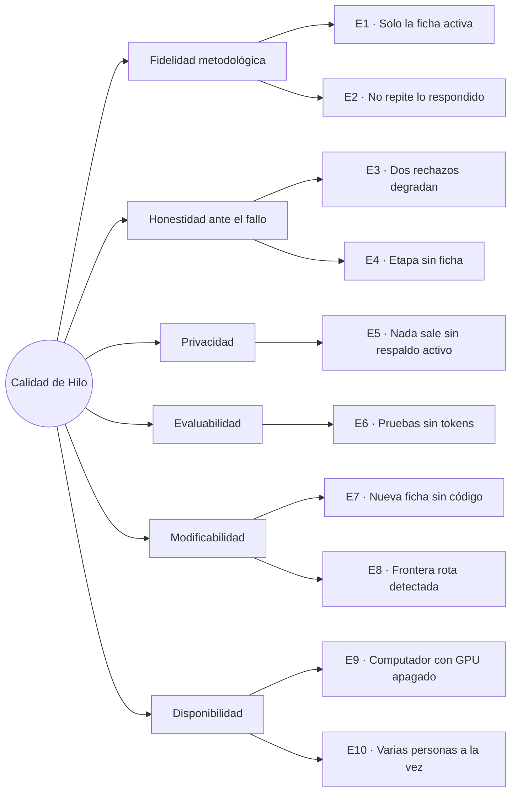

# Documentación de arquitectura de Hilo · arc42

Este documento sigue la plantilla [arc42](https://arc42.org) (versión 8), con sus doce
secciones. Las vistas de las secciones 3, 5, 6 y 7 se dibujan con el
[modelo C4](arquitectura-c4.md). Las secciones remiten a los documentos que ya existen cuando el
tema está tratado allí con más detalle.

Estado descrito: rama `main` al 27 de noviembre de 2026.

## Contenido

1. [Introducción y objetivos](#1-introducción-y-objetivos)
2. [Restricciones](#2-restricciones)
3. [Contexto y alcance](#3-contexto-y-alcance)
4. [Estrategia de solución](#4-estrategia-de-solución)
5. [Vista de bloques](#5-vista-de-bloques)
6. [Vista de ejecución](#6-vista-de-ejecución)
7. [Vista de despliegue](#7-vista-de-despliegue)
8. [Conceptos transversales](#8-conceptos-transversales)
9. [Decisiones de arquitectura](#9-decisiones-de-arquitectura)
10. [Requisitos de calidad](#10-requisitos-de-calidad)
11. [Riesgos y deuda técnica](#11-riesgos-y-deuda-técnica)
12. [Glosario](#12-glosario)

---

## 1. Introducción y objetivos

### 1.1 Requisitos funcionales

Hilo es el prototipo de un trabajo de grado. Acompaña proyectos de innovación con la
metodología **Ruta DIA**, que tiene 3 fases, 10 etapas y 15 fichas habilitadas.

| # | Capacidad | Detalle |
|---|---|---|
| F1 | Guiar una herramienta paso a paso | Cada turno lo resuelven un Orquestador, un Planificador, un Metodólogo y un Verificador, con un reintento como máximo |
| F2 | Proyectos persistentes | Cuadernos con contexto del reto, color, historial, memoria verificada y avance por parte de la ficha |
| F3 | Tableros interactivos | Árbol de problemas con diagnóstico, cinco porqués, PESTEL, mapa de empatía y recorrido del usuario |
| F4 | Práctica de entrevista | Cliente simulado; lo que se dice en la práctica nunca cuenta como evidencia |
| F5 | Organización personal | Post-its, tareas, agenda, calendario y avisos dentro de Hilo |
| F6 | Colaboración local | Cuentas, invitaciones, permisos de lectura o edición, avances comunes y tableros con versión |
| F7 | Evaluación para la investigación | Baterías, variantes de ablación y auditoría de cada veredicto |

### 1.2 Objetivos de calidad

Están ordenados por prioridad. La sección 10 los convierte en escenarios medibles.

| Prioridad | Objetivo | Motivación |
|---|---|---|
| 1 | **Fidelidad metodológica** | Lo que Hilo dice de una herramienta sale de su ficha. Un modelo pequeño se equivoca, así que el código decide si una respuesta cumple |
| 2 | **Honestidad ante el fallo** | Si falta una ficha, el modelo no responde o el Verificador rechaza dos veces, Hilo lo dice; nunca muestra algo que no cumple |
| 3 | **Privacidad y control local** | Los datos de los equipos se quedan en el equipo, salvo con el respaldo con Claude, que es opcional y se declara |
| 4 | **Evaluabilidad** | Cada pieza se prueba sin consumir tokens, cada veredicto queda auditado y las variantes se comparan con el mismo grafo |
| 5 | **Modificabilidad** | Cambiar de metodología es cambiar archivos, y las fronteras entre módulos están verificadas por una prueba |

### 1.3 Partes interesadas

| Rol | Expectativa |
|---|---|
| Investigador (autor del trabajo de grado) | Un sistema evaluable, reproducible y honesto sobre sus límites |
| Personas de los equipos de innovación | Una guía clara, una pregunta por turno, que no repita lo que ya contestaron y que guarde su trabajo |
| Persona experta en Ruta DIA | Que las fichas sean la única fuente y que Hilo no invente pasos |
| Jurado y director del trabajo de grado | Trazabilidad entre diseño, implementación y resultados |
| Quien opera el servidor | Despliegue reversible, datos fuera de la imagen y un servicio que se recupera solo |

---

## 2. Restricciones

### 2.1 Técnicas

| Restricción | Consecuencia |
|---|---|
| Modelo local pequeño (Qwen3.5-4B Q4_K_M en llama.cpp), en una GPU de consumo | Salidas cortas con JSON Schema estricto; los controles semánticos críticos se escriben en código |
| El modelo corre en el computador con GPU del equipo, no en el servidor | En el servidor llega por un túnel SSH; hace falta respaldo y degradación |
| Python 3.10 a 3.13, dependencias fijadas en `uv.lock` | La misma versión en CI, Docker y local |
| SQLite como única base | No hay base compartida entre computadores; un proceso escribe a la vez por proyecto |
| Windows y Linux | Scripts `.ps1` y `.sh`; los datos van fuera de OneDrive porque SQLite falla en carpetas sincronizadas |
| La interfaz escucha en `127.0.0.1` | La exposición externa la hace un proxy (nginx o cloudflared), nunca la aplicación |

### 2.2 Organizativas

| Restricción | Consecuencia |
|---|---|
| Trabajo de grado con un solo desarrollador | Monolito modular y no microservicios; documentación en español |
| Pruebas con participantes | Consentimiento informado que debe mencionar el envío de datos a Claude cuando el respaldo esté activo |
| Metodología de un tercero (Ruta DIA) | Las fichas se versionan aparte del código y requieren validación experta |

### 2.3 Convenciones

- `ruff` y `pytest` en cada cambio por GitHub Actions (`.github/workflows/ci.yml`); la interfaz
  se compila con `tsc` y Vite.
- `tests/test_arquitectura.py` hace cumplir las dependencias entre contextos delimitados.
- Ramas `main`, `staging` y `develop`, con integración por pull request (ver README).

---

## 3. Contexto y alcance

### 3.1 Contexto de negocio

El diagrama está en [C4 · nivel 1](arquitectura-c4.md#nivel-1--contexto-del-sistema).

| Interlocutor | Entrada a Hilo | Salida de Hilo |
|---|---|---|
| Persona del equipo | Mensajes, contexto del reto, tableros, notas, tareas, invitaciones | Una pregunta o acción por turno, veredicto, avance y tableros guardados |
| Investigador | Comandos y baterías de evaluación | Resultados, métricas y auditorías JSONL |
| Servidor del modelo local | Contratos JSON | Mensajes con el esquema de cada rol |
| API de Claude (opcional) | Contratos JSON, con un esquema adaptado | Mensajes del mismo contrato y uso de tokens para el registro de gasto |

### 3.2 Contexto técnico

| Canal | Protocolo | Notas |
|---|---|---|
| Navegador → Hilo | HTTP/JSON en `/api/*`, SSE en `POST /api/chat` | Cookie de sesión `httponly`; `TrustedHostMiddleware`; cuerpo máximo de 1 MiB |
| Hilo → modelo local | API compatible con OpenAI en `127.0.0.1:18083/v1` | `response_format: json_schema` estricto, sin reintentos del cliente, tiempo máximo configurable |
| Hilo → Claude | API de Anthropic por HTTPS | Salida estructurada; tope de gasto en USD |
| CLI → Hilo | Proceso local (`hilo chat`, `hilo interactive`) | Mismo grafo y misma memoria que la web |
| Exposición remota | nginx o `cloudflared` → `127.0.0.1:8787` | Fuera de la aplicación |

**Fuera de alcance:** proveedores de identidad, correo, notificaciones del sistema operativo,
RAG vectorial, base de datos compartida entre computadores, sincronización en tiempo real entre
colaboradores.

---

## 4. Estrategia de solución

| Objetivo | Estrategia | Dónde |
|---|---|---|
| Fidelidad metodológica | **El modelo propone y el código decide.** Contratos Pydantic entre roles, Planificador en código y Verificador con controles deterministas sobre la ficha | `acompanamiento/`, `compartido/contracts.py` |
| Fidelidad metodológica | **Aislamiento de contexto por agente.** El Orquestador ve el índice de la ruta, el Metodólogo una sola ficha y el plan | `direct_runtime.py` |
| Honestidad ante el fallo | Grafo explícito con un reintento, nodo `degrade` y nodo `knowledge_gap` | `langgraph_workflow.py` |
| Privacidad | Todo en `127.0.0.1`, datos por cuenta con permisos 700/600, Claude solo como respaldo declarado | `web.py`, `inferencia/respaldo_claude.py` |
| Evaluabilidad | Puertos sustituibles (runtime, modelo), variantes de ablación sobre el mismo grafo, auditoría JSONL | `variantes.py`, `audit.py`, `evaluacion/` |
| Modificabilidad | **Metodología como datos** y **monolito modular** con contextos delimitados verificados | `knowledge/`, `docs/dominio-ddd.md` |
| Varias personas a la vez | Fila de ranuras del modelo y un turno a la vez por proyecto | `inferencia/turnos.py` |

---

## 5. Vista de bloques

### 5.1 Nivel 1 · Sistema

Ver [C4 · nivel 2](arquitectura-c4.md#nivel-2--contenedores). Hilo tiene tres contenedores
ejecutables y cuatro almacenes:

| Bloque | Responsabilidad |
|---|---|
| Interfaz web (`frontend/`) | Pantallas, tableros y lectura del flujo SSE; no habla con el modelo |
| Aplicación Hilo (`src/hilo/`) | API, permisos, grafo, verificación, persistencia y archivos de la interfaz |
| Línea de comandos (`hilo`) | Turnos sin interfaz y evaluación |
| Base metodológica (`knowledge/`) | Ruta, fichas y partes |
| SQLite: cuentas, cuadernos, checkpoints | Estado durable |
| Auditoría JSONL | Un registro por veredicto |

### 5.2 Nivel 2 · Aplicación Hilo

Ver [C4 · nivel 3](arquitectura-c4.md#nivel-3--componentes-de-la-aplicación-hilo). Cada bloque
es un contexto delimitado; su responsabilidad, sus módulos y sus dependencias permitidas están
en [dominio-ddd.md](dominio-ddd.md#contextos-delimitados).

| Bloque | Tipo de subdominio | Interfaz que ofrece |
|---|---|---|
| `acompanamiento` | Núcleo | Grafo del turno: `ProjectState` → `TurnResult` |
| `conocimiento` | Soporte | Ruta, fichas, secciones y partes (solo lectura) |
| `herramientas` | Soporte | Forma y reglas de cada tablero |
| `practica` | Soporte | Cliente simulado y registro de prácticas |
| `proyectos` | Soporte | Agregados Proyecto y Proyecto compartido |
| `evaluacion` | Soporte | Baterías y métricas |
| `identidad` | Genérico | Cuentas y sesiones |
| `inferencia` | Genérico | Llamada al modelo, respaldo y colas |
| `compartido` | Núcleo compartido | Contratos y errores de dominio |
| Capa de entrada (`web.py`, `cli.py`, `config.py`) | — | Ensambla todo; único lugar que conoce HTTP |

### 5.3 Nivel 3 · Acompañamiento

| Bloque | Responsabilidad |
|---|---|
| Grafo (`langgraph_workflow.py`) | Nodos `orchestrate`, `plan`, `guide`, `verify`, `finalize`, `degrade`, `knowledge_gap` y sus condiciones |
| Agentes (`direct_runtime.py`, `variantes.py`) | Orquestador y Metodólogo sobre el modelo; la interfaz usa la variante `g` por defecto (`RUTA_DIA_VARIANTE`) |
| Planificador (`planificador.py`) | Decide preguntar, aclarar o cerrar y qué parte de la ficha se trabaja |
| Verificador (`guardrails.py`, `runtime.grounded_verdict`) | Invariantes del dominio; produce `Verdict` con hallazgos |
| Filtro sensible (`sensitive.py`) | Crisis y datos personales con texto fijo |
| Auditoría (`audit.py`) | `VerificationRecorder` escribe cada veredicto |
| Línea base (`crewai_runtime.py`) | Implementación heredada con CrewAI para comparar |

---

## 6. Vista de ejecución

### 6.1 Turno de chat aprobado

El diagrama de secuencia está en
[C4 · un turno de chat](arquitectura-c4.md#diagrama-complementario--un-turno-de-chat). En resumen:

1. `POST /api/chat` comprueba la sesión y el permiso, y bloquea el proyecto (`ProjectLocks`).
   Si el proyecto ya está respondiendo, devuelve 409.
2. Se abre el flujo SSE. El turno espera una ranura (`ModelQueue`) e informa a la interfaz
   cuántas respuestas faltan antes de la suya.
3. El grafo orquesta, planea, guía y verifica. Cada nodo emite un evento.
4. Con el veredicto aprobado se guardan el checkpoint, la auditoría, el turno, los campos
   validados y el avance, y se envía el `TurnResult`.

### 6.2 Rechazo y degradación

1. El Verificador rechaza la primera respuesta candidata con hallazgos (`repeated_question`,
   `unsupported_claim`…).
2. El grafo vuelve a `guide` una sola vez y le entrega los hallazgos al Metodólogo.
3. Si hay un segundo rechazo, `degrade` devuelve un texto seguro. El veredicto queda auditado
   y no se guarda ningún campo sin respaldo.

### 6.3 Etapa sin ficha

Si el Orquestador elige una etapa sin herramienta habilitada, `knowledge_gap` termina el turno
diciendo que esa parte de la metodología todavía no está disponible. No se le pide al modelo que
improvise.

### 6.4 Modelo local no disponible

1. La llamada a `llama-server` falla (túnel cerrado o computador apagado).
2. Con `RUTA_DIA_RESPALDO_CLAUDE` activo, `ConClaude` reemplaza solo esa llamada: el mismo
   contrato, con el esquema adaptado a Claude y validado después con Pydantic. El Metodólogo
   usa Opus y el Orquestador y el Cliente simulado usan Sonnet (configurables).
3. Cada llamada suma al registro de gasto. Al llegar al tope, o sin respaldo, se lanza
   `ModeloNoDisponible` y la interfaz informa que no hay modelo.

### 6.5 Edición concurrente de un tablero compartido

Cada tablero (árbol, PESTEL, mapa de empatía, recorrido) lleva un número de versión. Una edición
basada en una versión vieja se rechaza y la interfaz debe recargar. No hay fusión automática.

### 6.6 Práctica de entrevista

La persona conversa con el Cliente simulado, que recibe el personaje, el reto y los últimos
turnos, pero no las fichas. Las prácticas se guardan en tablas propias y se borran con su
proyecto. Nunca alimentan la memoria verificada.

---

## 7. Vista de despliegue

Diagrama en [C4 · despliegue](arquitectura-c4.md#diagrama-complementario--despliegue); pasos en
el README y en [contenedores.md](contenedores.md).

| Entorno | Nodo | Qué corre | Datos |
|---|---|---|---|
| A · Local | Computador Windows o Linux con GPU | Uvicorn en `127.0.0.1:8787` y `llama-server` en `127.0.0.1:18083` | `%LOCALAPPDATA%\RutaDIA` o `~/.local/share/RutaDIA` |
| B · Servidor | VPS Ubuntu 24.04 ARM64 | nginx (del servidor), Hilo con systemd (paso a Docker planeado para noviembre de 2026) | `~/hilo/datos`, montado en `/datos` en Docker |
| B · Servidor | Computador con GPU del equipo | `llama-server`, publicado por un túnel SSH inverso con una llave restringida a ese puerto | — |
| C · Túnel rápido | Instalación local A + `cloudflared` | Dirección `*.trycloudflare.com` temporal y código de invitación | Los de A |

Características de la imagen Docker: tres etapas (Node 24, uv, `python:3.13-slim`), usuario sin
privilegios con el UID del servidor, sistema de archivos de solo lectura, sin capacidades extra,
red del host, comprobación de salud en `/api/status` y reinicio automático.

---

## 8. Conceptos transversales

### 8.1 Modelo de dominio

Lenguaje ubicuo, agregados e invariantes en [dominio-ddd.md](dominio-ddd.md). Las invariantes se
aplican en código y no en el modelo de lenguaje.

### 8.2 Contratos entre agentes

Todo lo que pasa entre nodos es un modelo Pydantic estricto (`HandoffContract`, `Plan`,
`CandidateResponse`, `Verdict`, `TurnResult`). El modelo de lenguaje recibe el JSON Schema del
contrato y su salida se valida. Una salida que no cumple es un rechazo, no una respuesta. Esta es
la capa anticorrupción entre el núcleo y la inferencia.

### 8.3 Persistencia

| Almacén | Dueño | Contenido |
|---|---|---|
| `auth.sqlite3` | `identidad`, `proyectos.sharing` | Cuentas, sesiones, invitaciones, miembros, avances, tableros compartidos |
| `users/<id>/notebooks.sqlite3` | `proyectos.memory`, `practica.registro` | Cuadernos, turnos, campos verificados, avance, Post-its, tareas, prácticas |
| `users/<id>/checkpoints.sqlite3` | LangGraph | Estado técnico del hilo, serializado como JSON |
| `users/<id>/verifications.jsonl` | `acompanamiento.audit` | Veredictos |
| `knowledge/` | `conocimiento` | Metodología versionada en Git |

Una conversación nunca se incorpora automáticamente a la base metodológica. El modelo recibe
ocho intervenciones recientes; el historial completo queda en SQLite.

### 8.4 Seguridad

- **Contraseñas** con `scrypt` (n = 2¹⁵, r = 8, p = 3) y sal aleatoria.
- **Sesiones** de 12 horas: el token va en una cookie `httponly` y en la base solo se guarda su
  SHA-256.
- **Cupos de intentos:** 5 inicios de sesión y 20 accesos por minuto y origen.
- **Hosts de confianza:** solo `localhost` y los dominios de `HILO_HOSTS_PUBLICOS`.
- **Registro desde afuera** con el código de `HILO_CODIGO_INVITACION`.
- **Cuerpo de petición** de 1 MiB como máximo; avatares de 512 KiB como máximo.
- **Carpeta de datos** con permisos 700/600 en Linux.
- **Permisos por proyecto:** propietario, edición o lectura, comprobados en la capa de entrada.
- **Contenido sensible** (crisis, datos personales) respondido con texto fijo.
- **Secretos** solo en `.env` (ignorado por Git) o en los `env_file` de Compose, fuera de la
  imagen.

### 8.5 Concurrencia

`ModelQueue` deja pasar tantas generaciones como ranuras tenga `llama-server`
(`RUTA_DIA_PARALLEL`, 6 por defecto) y forma a las demás en orden de llegada, con latidos para
que la conexión SSE no quede muda. `ProjectLocks` impide dos turnos simultáneos sobre el mismo
hilo de LangGraph y la misma memoria.

### 8.6 Manejo de errores

Los contextos lanzan `ErrorDeDominio` con un mensaje y un estado, sin conocer HTTP. La capa de
entrada los convierte en respuestas JSON. Los fallos del modelo pasan por la degradación (6.2) o
por el respaldo (6.4).

### 8.7 Configuración

Variables `RUTA_DIA_*` (runtime, modelo, endpoint, clave local, datos, variante, respaldo, tope)
y `HILO_*` (puerto, hosts públicos, código de invitación, UID/GID en Docker). Están descritas en
`.env.example`, en el README y en `config.py`.

### 8.8 Pruebas y evaluación

- Las pruebas automatizadas (`tests/`) usan dobles del modelo y no consumen tokens.
- `test_arquitectura.py` verifica las fronteras entre contextos.
- Las baterías de `scripts/evaluate_langgraph.py` y `evaluation/` miden el comportamiento con
  el modelo real.
- `variantes.py` permite estudios de ablación sobre el mismo grafo.

---

## 9. Decisiones de arquitectura

Registro breve; el contexto histórico de las primeras decisiones está en
[arquitectura.md](arquitectura.md) y [arquitectura-langgraph.md](arquitectura-langgraph.md).

| # | Decisión | Alternativas descartadas | Motivo | Consecuencia |
|---|---|---|---|---|
| D1 | **Flujo explícito con LangGraph** controla el orden de los roles | Conversación autónoma entre agentes de CrewAI | Que el modelo no decida el flujo crítico; probar cada frontera sin tokens; auditar cada dictamen | CrewAI queda solo como línea base |
| D2 | **Modelo local pequeño** (Qwen3.5-4B) en llama.cpp con JSON Schema estricto | Modelo grande en la nube como principal; modelo local de 27B | Privacidad, costo cero por turno y hardware disponible | Hay variabilidad semántica, así que los controles críticos se escriben en código (D4) |
| D3 | **El modelo propone, el código decide**: contratos Pydantic y un solo reintento | Confiar en el texto libre del modelo; reintentos ilimitados | Honestidad y latencia acotada | Hay respuestas degradadas visibles |
| D4 | **Planificador y Verificador en código** (variante `g`) en la interfaz | Verificador con modelo (variante `a`); un solo agente (`d`) | Los falsos rechazos del modelo pequeño y que el avance viva fuera del modelo | Las reglas se mantienen a mano y se respaldan en las fichas |
| D5 | **Monolito modular** con contextos delimitados verificados por prueba | Microservicios, uno por agente | Un solo desarrollador; Planificador y Verificador responden en milisegundos y la red solo sumaría latencia | Los contextos marcan dónde cortar en el futuro: inferencia, conocimiento, práctica, proyectos con identidad |
| D6 | **Metodología como archivos versionados** (JSON y Markdown) | RAG vectorial; fichas en base de datos | Fuente única, revisable por una persona experta y con diferencias en Git | Cambiar de metodología es cambiar archivos; no hay búsqueda semántica |
| D7 | **SQLite por cuenta**, con checkpoints aparte, fuera de OneDrive | Base de datos servidor (PostgreSQL); una sola base | Instalación sin servicios extra y aislamiento entre cuentas | No hay base compartida entre computadores; respaldar es copiar la carpeta |
| D8 | **Respaldo con Claude** solo en la llamada al modelo, con tope de gasto | Sin respaldo; Claude como modelo principal | Que Hilo responda aunque el computador con GPU esté apagado, sin cambiar el resto del turno | Los datos salen del equipo cuando se usa; debe declararse |
| D9 | **SSE** para transmitir el turno | WebSocket; respuesta única al final | Un solo sentido basta; muestra la fila y el avance de los nodos | Un turno por proyecto a la vez (409 si ya responde) |
| D10 | **Un contenedor Docker** para la aplicación; nginx y modelo fuera | Imagen con el modelo; un contenedor por contexto | El modelo necesita la GPU de otro computador; nginx atiende otros sitios | Despliegue reversible en un minuto; datos en volúmenes |

---

## 10. Requisitos de calidad

### 10.1 Árbol de calidad

### 10.2 Escenarios

| # | Estímulo | Respuesta esperada | Medida |
|---|---|---|---|
| E1 | El Metodólogo cita una sección que no existe en la ficha activa | El Verificador rechaza con `structural_violation` o `unsupported_claim` | El 100 % de esos casos de prueba se rechaza |
| E2 | La persona ya respondió una parte de la herramienta | El Planificador no la vuelve a elegir; si el Metodólogo la pide, hay rechazo `repeated_known_field` | Cero preguntas repetidas en la batería |
| E3 | Dos respuestas candidatas no cumplen | Hilo responde con un texto seguro y lo audita | Ningún turno degradado muestra la respuesta rechazada |
| E4 | Se pide trabajar una etapa sin ficha habilitada | `knowledge_gap` lo comunica | Sin llamada al Metodólogo |
| E5 | Turno con el modelo local disponible | Ningún dato sale del equipo | Cero llamadas a la API de Claude |
| E6 | Un desarrollador ejecuta `pytest` | Toda la suite corre con dobles del modelo | Sin red ni tokens; corre en CI en cada cambio |
| E7 | La persona experta agrega o corrige una ficha | Se edita `knowledge/` y `partes_fichas.json` | Sin cambios en `src/` |
| E8 | Un módulo importa un contexto que no le corresponde | `test_arquitectura.py` falla en CI | Antes de integrar |
| E9 | Se cierra el túnel del modelo en el servidor | El respaldo con Claude atiende el turno; sin respaldo, el mensaje lo dice | El turno no se cuelga más que `RUTA_DIA_TIMEOUT` |
| E10 | Llegan más turnos que ranuras del modelo | Los demás esperan en orden y ven su posición | Sin errores por concurrencia ni turnos simultáneos en un mismo proyecto |

---

## 11. Riesgos y deuda técnica

### 11.1 Riesgos

| Riesgo | Probabilidad / impacto | Mitigación actual |
|---|---|---|
| El computador con GPU está apagado o sin túnel durante las pruebas con participantes | Alta / alto | Respaldo con Claude con tope de gasto; mensaje explícito sin modelo |
| La variabilidad semántica del modelo de 4B produce respuestas pobres pero válidas | Media / alto | Planificador y Verificador en código; evaluación con personas expertas pendiente |
| Datos de participantes enviados a Claude | Media / alto | El respaldo es opcional y debe declararse en el consentimiento informado |
| La dirección del túnel rápido de Cloudflare queda expuesta | Media / medio | Código de invitación, cupos de intentos y hosts de confianza; la dirección cambia cada vez |
| Un solo servidor y SQLite: el disco o el proceso fallan | Baja / alto | Copia de la carpeta de datos antes de cada cambio; reinicio automático; volver al servicio anterior |
| Las fichas aún no están validadas por una persona experta | Alta / medio | Las fichas son la única fuente y se pueden revisar en Git |

### 11.2 Deuda técnica

| Deuda | Efecto | Pago propuesto |
|---|---|---|
| `web.py` tiene unas 1.480 líneas y es la entrada de todos los contextos | Cuesta leer y revisar | Un `APIRouter` por contexto, sin cambiar el diseño |
| Las prácticas comparten el SQLite del cuaderno | Acopla `practica` y `proyectos` en el almacenamiento | Borrar las prácticas con un evento al borrar el proyecto |
| Variantes y respaldo por herencia y mezcla de clases | La capa anticorrupción es menos limpia | Composición: inyectar el puerto del modelo |
| Documentos desactualizados | `arquitectura-langgraph.md` describe un Verificador con modelo; el docstring de `variantes.py` dice que la interfaz no usa variantes (usa `g`); el README dice que no hay despliegue remoto, pero existe el del servidor | Actualizarlos y enlazar este documento |
| Sin fusión de ediciones concurrentes en los tableros | Una edición sobre una versión vieja se pierde y hay que recargar | Fusión por elemento o edición en tiempo real, si el uso lo pide |

---

## 12. Glosario

Los términos del dominio (ruta, etapa, ficha, parte, avance, plan, turno, traspaso, veredicto,
cuaderno, práctica, respaldo) están en el
[lenguaje ubicuo](dominio-ddd.md#lenguaje-ubicuo). Términos de arquitectura:

| Término | Significado |
|---|---|
| Contexto delimitado | Frontera de modelo y lenguaje en DDD; una carpeta de `src/hilo/` |
| Monolito modular | Un solo programa desplegado, dividido internamente en módulos con dependencias controladas |
| Capa anticorrupción | Traducción entre el núcleo y un sistema externo (el modelo) para que el núcleo no dependa de su forma |
| Lenguaje publicado | Formato fijo y documentado con el que un contexto expone sus datos (las fichas) |
| Checkpoint | Estado del grafo de LangGraph guardado al final de cada nodo, por hilo |
| Hilo (`thread_id`) | Identificador de la conversación en LangGraph; es el del cuaderno |
| Ranura | Generación simultánea que admite `llama-server` |
| SSE | *Server-Sent Events*: flujo HTTP de un solo sentido, del servidor al navegador |
| Variante | Configuración de agentes para el estudio de ablación (`a`…`h`); la interfaz usa `g` |
| Degradación | Respuesta segura que reemplaza a una que no pasó la verificación |
| Respaldo | Claude atendiendo la llamada al modelo cuando el local no responde |
