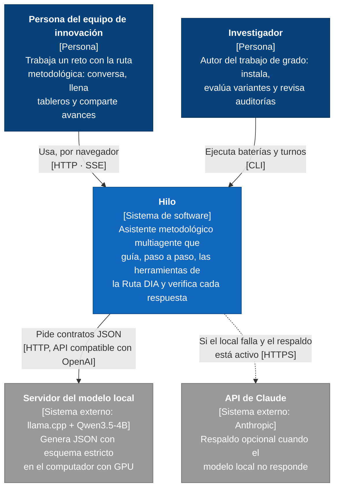
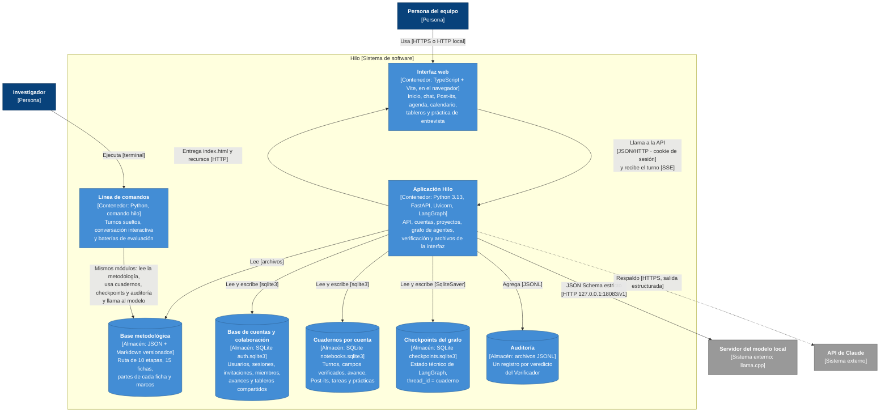
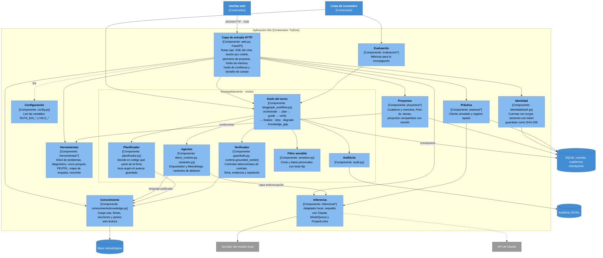
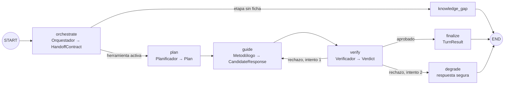
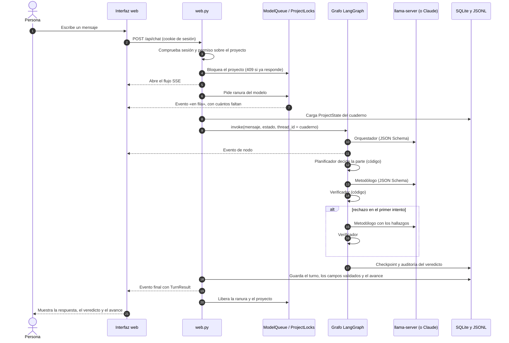

# Arquitectura de Hilo · modelo C4

Este documento describe Hilo con el [modelo C4](https://c4model.com) de Simon Brown: cuatro
niveles de zoom, del sistema visto desde afuera hasta el código. Complementa la plantilla
[arc42](arquitectura-arc42.md), que reúne objetivos, restricciones, decisiones y riesgos.

Los diagramas usan Mermaid (GitHub los dibuja) con la notación de C4: cada caja indica su tipo
y su tecnología entre corchetes. Las flechas van de quien usa a quien es usado y llevan el
protocolo.

| Nivel | Pregunta que responde | Sección |
|---|---|---|
| 1 · Contexto | ¿Quién usa Hilo y con qué sistemas habla? | [Contexto del sistema](#nivel-1--contexto-del-sistema) |
| 2 · Contenedores | ¿Qué programas y almacenes forman Hilo? | [Contenedores](#nivel-2--contenedores) |
| 3 · Componentes | ¿Qué hay dentro de la aplicación? | [Componentes](#nivel-3--componentes-de-la-aplicación-hilo) |
| 4 · Código | ¿Cómo está escrito un componente? | [Código](#nivel-4--código) |
| Complementario | ¿Dónde corre cada pieza? | [Despliegue](#diagrama-complementario--despliegue) |
| Complementario | ¿Qué pasa en un turno de chat? | [Dinámico](#diagrama-complementario--un-turno-de-chat) |

Estado descrito: rama `main` al 27 de noviembre de 2026, variante de agentes `g`
(`PlanificadorConControles`, la que usa la interfaz por defecto).

---

## Nivel 1 · Contexto del sistema

- **Personas.** Hilo es un prototipo de trabajo de grado. Lo usan miembros de un equipo que
  trabaja un reto de innovación, cada uno con su cuenta local, y el investigador, que además
  lo evalúa desde la línea de comandos.
- **Servidor del modelo local.** Es otro programa (`llama-server`), con su propio ciclo de vida
  y su GPU. Hilo lo trata como un sistema externo: si no está, Hilo no puede guiar el turno.
- **API de Claude.** Es opcional (`RUTA_DIA_RESPALDO_CLAUDE`) y tiene un tope de gasto
  (`RUTA_DIA_CLAUDE_TOPE_USD`). Lo que se le envía sale del equipo, y el consentimiento
  informado de las pruebas debe decirlo.
- **Lo que no hay.** No hay proveedores de identidad, correo, avisos del sistema operativo ni
  RAG vectorial. La metodología vive dentro del repositorio.

---

## Nivel 2 · Contenedores

En C4, un *contenedor* es una unidad que se ejecuta o que guarda datos, no necesariamente un
contenedor Docker. Hilo es un **monolito modular**: un solo proceso de Python sirve la API, los
agentes y la interfaz ya compilada.

| Contenedor | Tecnología | Responsabilidad | Dónde está |
|---|---|---|---|
| Interfaz web | TypeScript, Vite, pnpm | Pantallas y tableros; no habla con el modelo | `frontend/` |
| Aplicación Hilo | Python, FastAPI, Uvicorn, LangGraph, Pydantic | API, sesión, permisos, grafo, verificación, colas | `src/hilo/` (entrada `web.py`) |
| Línea de comandos | Python (`hilo`) | Turnos e interacción sin interfaz, evaluación | `src/hilo/cli.py`, `scripts/` |
| Base metodológica | JSON y Markdown | Fuente única de lo que Hilo dice de cada herramienta | `knowledge/`, `conocimiento/partes_fichas.json` |
| Cuentas y colaboración | SQLite | Identidad y proyectos compartidos | `<datos>/auth.sqlite3` |
| Cuadernos | SQLite, uno por cuenta | Memoria del proyecto y prácticas | `<datos>/users/<id>/` |
| Checkpoints | SQLite (LangGraph) | Reanudar el hilo de cada cuaderno | junto a los cuadernos |
| Auditoría | JSONL | Trazabilidad de cada veredicto | `<datos>/users/<id>/verifications.jsonl`, `data/` |

La línea de comandos importa los mismos módulos que la aplicación y usa los mismos almacenes y
el mismo modelo; el diagrama dibuja una sola flecha para no repetir las de la aplicación.

`<datos>` es `%LOCALAPPDATA%\RutaDIA` en Windows, `~/.local/share/RutaDIA` en Linux o
`RUTA_DIA_DATA_DIR` si se define. En la imagen Docker es `/datos`.

---

## Nivel 3 · Componentes de la aplicación Hilo

Cada componente corresponde a un **contexto delimitado** de `src/hilo/`
([dominio-ddd.md](dominio-ddd.md)). La prueba `tests/test_arquitectura.py` hace cumplir las
dependencias que muestra este diagrama: si un módulo importa un contexto que no le corresponde,
falla.

Falta un componente en el dibujo: **Compartido** (`compartido/`), con los contratos Pydantic y
los errores de dominio. Todos los contextos dependen de él, así que se omite para no cargar el
diagrama con esas flechas.

| Componente | Responsabilidad | Interfaz principal |
|---|---|---|
| Capa de entrada HTTP | Traduce HTTP a llamadas de los contextos y los `ErrorDeDominio` a códigos HTTP. Arma un turno por petición en un hilo aparte y lo transmite por SSE | `create_app`, `run_server`, `POST /api/chat` |
| Grafo del turno | Decide el orden, las bifurcaciones y el único reintento | `LangGraphRutaDia` |
| Agentes | Llaman al modelo con un contexto aislado por rol y validan la salida con Pydantic | `DirectOpenAIRuntime`, `VARIANTES` |
| Planificador | Elige preguntar, aclarar o cerrar y qué parte se trabaja, a partir del avance guardado | `planear` → `Plan` |
| Verificador | Protege las invariantes del dominio; con dos rechazos, el turno se degrada | `validate_handoff`, `validate_candidate`, `grounded_verdict` → `Verdict` |
| Conocimiento | Expone la metodología como datos | `RouteDefinition`, `partes_de` |
| Herramientas | Forma y reglas de cada tablero | `problem_tree`, `why_analysis`, `pestel`… |
| Proyectos | Agregados Proyecto y Proyecto compartido | `NotebookMemory`, `SharingStore` |
| Identidad | Agregado Cuenta | `AuthStore` |
| Práctica | Entrevista con el Cliente simulado; nunca es evidencia | `cliente_simulado`, `RegistroPracticas` |
| Inferencia | Única puerta al modelo; reparte las ranuras y bloquea un proyecto por turno | `llamar_modelo_local`, `ConClaude`, `ModelQueue`, `ProjectLocks` |
| Evaluación | Baterías y métricas; la web no la usa | `evaluation` |

---

## Nivel 4 · Código

C4 recomienda dibujar este nivel solo donde aporta. En Hilo, el único lugar donde aporta es el
grafo del turno ([`langgraph_workflow.py`](../src/hilo/acompanamiento/langgraph_workflow.py)):

Los contratos entre nodos (`HandoffContract`, `Plan`, `CandidateResponse`, `Verdict`,
`TurnResult`, `ProjectState`) están en
[`compartido/contracts.py`](../src/hilo/compartido/contracts.py). El resto del código se lee
mejor directamente; el mapa de módulos por contexto está en [dominio-ddd.md](dominio-ddd.md).

---

## Diagrama complementario · despliegue

Hilo se ejecuta de tres formas. Las tres usan el mismo código y solo cambian la configuración.

```mermaid
flowchart TB
    subgraph local["A · Instalación local (Windows o Linux)"]
        direction LR
        nav1["Navegador"] -- "HTTP 127.0.0.1:8787" --> app1["Aplicación Hilo<br/>[Uvicorn]"]
        app1 -- "HTTP 127.0.0.1:18083" --> llm1["llama-server + Qwen3.5-4B<br/>[GPU del mismo equipo]"]
        app1 --> d1[("Carpeta de datos<br/>%LOCALAPPDATA%\RutaDIA")]
    end

    subgraph servidor["B · Servidor del equipo (Ubuntu 24.04 ARM64)"]
        direction LR
        nav2["Navegador remoto"] -- "HTTP(S) según nginx" --> nginx["nginx<br/>[proxy reverso del servidor,<br/>configurado fuera del repositorio]"]
        nginx -- "HTTP 127.0.0.1:8787" --> app2["Aplicación Hilo<br/>[systemd hoy · Docker planeado,<br/>red del host, solo lectura]"]
        app2 --> d2[("~/hilo/datos<br/>[volumen /datos]")]
        app2 -- "127.0.0.1:18083<br/>[túnel SSH inverso]" --> llm2["llama-server<br/>[computador con GPU del equipo,<br/>scripts/prestar_modelo.sh]"]
        app2 -. "si el túnel está cerrado [HTTPS]" .-> claude2["API de Claude"]
    end

    subgraph tunel["C · Acceso temporal desde otro computador"]
        direction LR
        nav3["Navegador remoto"] -- "HTTPS *.trycloudflare.com" --> cf["cloudflared<br/>[túnel rápido]"]
        cf -- "HTTP 127.0.0.1:8787" --> app3["Aplicación Hilo<br/>[instalación local A]"]
    end
```

- **A · Local.** Es el modo documentado en el README: todo escucha en `127.0.0.1` y nada sale
  del equipo.
- **B · Servidor.** Hilo corre detrás del nginx del servidor. El modelo no va en el servidor:
  llega por un túnel SSH cuya llave solo puede abrir `127.0.0.1:18083`. Si el túnel se cierra,
  responde el respaldo con Claude, si está activo. El paso a Docker está preparado y probado
  ([contenedores.md](contenedores.md)).
- **C · Túnel rápido.** `scripts/abrir_tunel.sh` publica la instalación local con una dirección
  `trycloudflare.com` que cambia cada vez. Crear una cuenta desde afuera exige un código de
  invitación, y el registro y el inicio de sesión tienen un cupo de intentos por minuto.

---

## Diagrama complementario · un turno de chat

