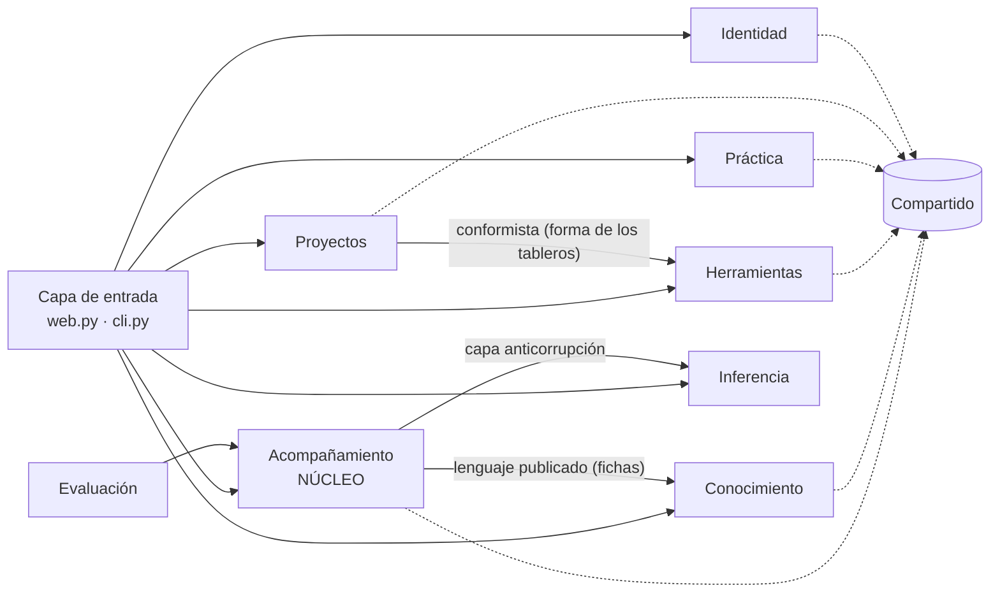

# Diseño guiado por el dominio (DDD) en Hilo

Hilo es un **monolito modular**: se despliega como un solo programa, pero el código está dividido
en **contextos delimitados** (*bounded contexts*, Evans), uno por carpeta de
`src/hilo/`. Cada contexto tiene su responsabilidad, su lenguaje y una lista cerrada de
contextos de los que puede depender. Esa lista no es solo documentación: la prueba
`tests/test_arquitectura.py` lee las importaciones del código y falla si alguien la rompe.

## Subdominios

| Tipo | Contexto | Por qué |
|---|---|---|
| **Núcleo** | Acompañamiento metodológico | Es lo que distingue a Hilo: guiar una herramienta paso a paso con agentes. |
| Soporte | Conocimiento metodológico, Herramientas de trabajo, Práctica de entrevista, Proyectos y colaboración, Evaluación | Propios del problema, pero al servicio del núcleo. |
| Genérico | Identidad y acceso, Inferencia | Cualquier sistema los tiene; podrían comprarse o reemplazarse. |

## Contextos delimitados

| Contexto (carpeta) | Responsabilidad | Módulos | Depende de |
|---|---|---|---|
| `compartido` | Núcleo compartido: contratos entre agentes y errores del dominio | `contracts`, `errores` | — |
| `acompanamiento` | Decidir, turno a turno, qué parte se trabaja y qué respuesta se muestra | `langgraph_workflow`, `planificador`, `runtime`, `direct_runtime`, `variantes`, `guardrails`, `sensitive`, `service`, `audit`, `crewai_runtime` (heredado) | compartido, conocimiento, inferencia |
| `conocimiento` | La metodología como datos: ruta, fichas y partes; solo lectura | `knowledge`, `partes_fichas.json` | compartido |
| `herramientas` | Forma y reglas de los tableros (mapa de empatía, recorrido, PESTEL, árbol, cinco porqués) | `empathy_map`, `journey`, `journey_extract`, `pestel`, `problem_tree`, `tree_diagnosis`, `why_analysis` | compartido |
| `practica` | Cliente simulado y registro de prácticas de entrevista | `cliente_simulado`, `registro` | compartido |
| `proyectos` | Cuaderno del proyecto, notas, tareas y proyectos compartidos | `memory`, `notes`, `tasks`, `sharing` | compartido, herramientas |
| `identidad` | Cuentas, sesiones y perfil | `auth` | compartido |
| `inferencia` | Acceso a los modelos: servidor local, respaldo con Claude y fila de turnos | `modelo_local`, `respaldo_claude`, `turnos` | — |
| `evaluacion` | Mediciones para la investigación (la web no la usa) | `evaluation` | acompanamiento, compartido, conocimiento, inferencia |

Fuera de los contextos solo queda la **capa de entrada**, que arma la aplicación y puede usarlos
todos: `web.py` (API y páginas), `cli.py` (línea de comandos) y `config.py` (configuración, que
cualquiera puede leer).

## Mapa de contextos

Las flechas van del contexto que usa (aguas abajo) al que provee (aguas arriba).

- **Acompañamiento → Conocimiento: lenguaje publicado.** Las fichas y la ruta son archivos con un
  formato fijo; el núcleo las consume tal cual. Cambiar de metodología es cambiar archivos.
- **Acompañamiento → Inferencia: capa anticorrupción.** El núcleo nunca recibe texto libre del
  modelo: pide a través de `DirectOpenAIRuntime._llamar` y valida la salida con los contratos de
  Pydantic; si no cumple el contrato, se rechaza. Por eso el respaldo con Claude
  (`respaldo_claude.ConClaude`) reemplaza solo ese paso y el resto del turno sigue igual.
- **Proyectos → Herramientas: conformista.** Los proyectos compartidos guardan los tableros con la
  forma que define cada herramienta.
- **Proyectos ↔ Acompañamiento: a través de la capa de entrada.** `web.py` carga el estado del
  proyecto (`ProjectState`), se lo pasa al grafo y guarda el resultado del turno (`TurnResult`).
  Los dos contextos no se importan entre sí: solo comparten los contratos.
- **Inferencia no conoce a nadie.** No sabe de agentes, fichas ni proyectos. Esa es la condición
  para poder separarla como servicio o cambiar de proveedor.

## Lenguaje ubicuo

El código mezcla inglés y español por su historia; esta tabla fija qué significa cada término y
cómo aparece en el código.

| Término | Significado | En el código |
|---|---|---|
| Ruta | La metodología completa: 3 fases y 10 etapas | `RouteDefinition`, `ruta-dia.json` |
| Etapa | Momento de la ruta con sus herramientas | `StageDefinition`, `stage` |
| Herramienta | Técnica concreta (PESTEL, mapa de empatía…) | `ToolDefinition`, `tool_id` |
| Ficha | Documento que explica una herramienta; única fuente de lo que Hilo dice de ella | `tool_card`, `prompt_card` |
| Sección | Parte citable de una ficha | `card_section` |
| Parte | Lo que la persona debe completar en una herramienta (82 en 14 fichas) | `Parte`, `partes_de` |
| Avance | Estado de cada parte: pendiente, respondida o sin dato | `progreso` |
| Plan | Lo que el Planificador decide para el turno: preguntar, aclarar o cerrar | `Plan`, `planear` |
| Turno | Un mensaje de la persona y la respuesta de Hilo | `TurnResult` |
| Pedido | Qué quiere la persona: trabajar, explicar, recomendar, saludar, resumen… | `RequestKind` |
| Traspaso | Lo que el Orquestador entrega al resto: pedido y ficha activa | `HandoffContract` |
| Respuesta candidata | Lo que propone el Metodólogo antes de revisarse | `CandidateResponse` |
| Veredicto / hallazgo | Decisión del Verificador y sus motivos | `Verdict`, `VerificationFinding` |
| Proyecto (cuaderno) | El trabajo de una persona o equipo sobre un reto | `notebook`, `NotebookMemory` |
| Práctica | Entrevista de ensayo con el Cliente simulado; nunca es evidencia | `RegistroPracticas` |
| Respaldo | Claude respondiendo cuando el modelo local no está | `ConClaude`, `Respaldo` |

## Agregados

| Agregado | Raíz | Qué protege | Dónde |
|---|---|---|---|
| Proyecto | Cuaderno (`notebooks`) | El historial de turnos, los campos validados y el avance se cambian juntos y en orden; un proyecto genera una sola respuesta a la vez (`inferencia.turnos.ProjectLocks`) | `proyectos/memory.py` |
| Proyecto compartido | `shared_projects` | Solo el propietario comparte; cada tablero lleva versión y rechaza ediciones sobre una versión vieja | `proyectos/sharing.py` |
| Práctica | `practicas` | Sus turnos solo los ve quien la creó; se borra con su proyecto | `practica/registro.py` |
| Cuenta | `users` | Credenciales, sesiones y perfil | `identidad/auth.py` |

## Invariantes del dominio

Son las reglas que una respuesta nunca puede romper. Se aplican en código determinista, no en el
modelo de lenguaje: el modelo propone y el código decide si la propuesta cumple. Si el Verificador
rechaza dos veces, Hilo responde con un texto seguro en lugar de mostrar algo que no cumple.

| Invariante | Dónde se aplica | Hallazgo si se rompe |
|---|---|---|
| Qué parte de la herramienta se trabaja lo decide el avance guardado, no el modelo | `acompanamiento/planificador.py` (`planear`) | — (el Metodólogo recibe el plan ya decidido) |
| La respuesta trabaja la ficha activa que eligió el Orquestador | `acompanamiento/guardrails.py` (`validate_candidate`) | `structural_violation` |
| Solo se recomiendan herramientas permitidas en la etapa | `acompanamiento/guardrails.py` (`validate_handoff`) | `structural_violation` |
| Lo que se dice de una herramienta sale de su ficha y cita secciones que existen | `guardrails.py` y `runtime.grounded_verdict` | `structural_violation`, `unsupported_claim` |
| Una sola pregunta o acción por turno | `runtime.grounded_verdict` | `interaction_error` |
| No repetir la pregunta anterior | `runtime.grounded_verdict` | `repeated_question` |
| No volver a pedir lo que la persona ya respondió | `runtime.grounded_verdict` y `variantes` (con el avance del Planificador) | `repeated_known_field` |
| Solo se anotan campos declarados en la ficha y respaldados por lo que dijo la persona | `guardrails.py` y `runtime.grounded_verdict` | `unsupported_template_update` |
| Temas delicados, crisis y datos personales se responden con texto fijo | `acompanamiento/sensitive.py` | `sensitive_content` |
| Lo simulado nunca entra como evidencia del proyecto | `practica/registro.py` (tablas aparte) | — |

En términos de DDD, el Planificador es un servicio de dominio con estado sobre el agregado
Proyecto (el avance se guarda con cada turno) y el Verificador es una política de dominio que
protege estas invariantes antes de que la respuesta llegue a la persona.

## Contextos delimitados y aislamiento entre agentes

Son dos ideas distintas que se complementan, y conviene no confundirlas:

- Un **contexto delimitado** (DDD) es una frontera de modelo y de lenguaje. El Orquestador, el
  Planificador, el Metodólogo y el Verificador hablan el mismo lenguaje (turno, ficha, parte,
  veredicto), así que los cuatro pertenecen al mismo contexto: acompañamiento. El Cliente simulado
  sí está en otro contexto (práctica), con otro lenguaje y otro propósito.
- El **aislamiento entre agentes** es un principio del diseño multiagente: cada agente recibe
  solo la información que su función necesita. Con eso Hilo leyó un 33 % menos de tokens por turno
  que un agente único y no desbordó la ventana de contexto del modelo.

| Agente | Recibe | No recibe |
|---|---|---|
| Orquestador | El mensaje, el estado del proyecto (sin el avance de la ficha) y el índice de la ruta | Las fichas completas |
| Planificador (reglas) | El avance guardado, las partes de la ficha activa y el mensaje | — (no usa el modelo) |
| Metodólogo | La ficha activa y el plan del turno | Las demás fichas y la ruta |
| Verificador (reglas) | La respuesta candidata, la ficha, el mensaje y el estado | — (no usa el modelo) |
| Cliente simulado | El personaje, el reto y los últimos turnos de la práctica | Las fichas y la metodología |

Los contextos delimitados se formalizaron el 26 de octubre de 2026, sobre una arquitectura cuyos
agentes ya estaban aislados desde el diseño inicial: DDD no cambió a los agentes, hizo explícitas
y verificables las fronteras entre módulos.

## Deuda conocida

- **`web.py` es grande** (unas 1.460 líneas): es la capa de entrada de todos los contextos. Separarlo
  en un enrutador por contexto no cambia el diseño y queda pendiente.
- **Las prácticas comparten el archivo SQLite del proyecto** para que la clave foránea borre las
  prácticas junto con su proyecto. El esquema y las consultas son del contexto `practica`. Separar
  la base exigiría borrar las prácticas con un evento cuando se borre el proyecto.
- **Las variantes de agentes heredan del adaptador local** (`variantes` → `DirectOpenAIRuntime`) y
  el respaldo se aplica como mezcla de clases. Funciona y está probado, pero pasar el acceso al
  modelo por composición en vez de herencia haría más limpia la capa anticorrupción.

## Hacia servicios

Los contextos son también la línea de corte si algún día hace falta separar servicios. No sería
uno por agente: el Planificador y el Verificador son reglas que responden en milisegundos, y
ponerlos detrás de la red solo sumaría latencia. Los cortes naturales, en este orden, son:
inferencia (ya corre como servidor aparte), conocimiento (solo lectura), práctica de entrevista, y
proyectos con identidad. El acompañamiento seguiría siendo el coordinador del turno.
